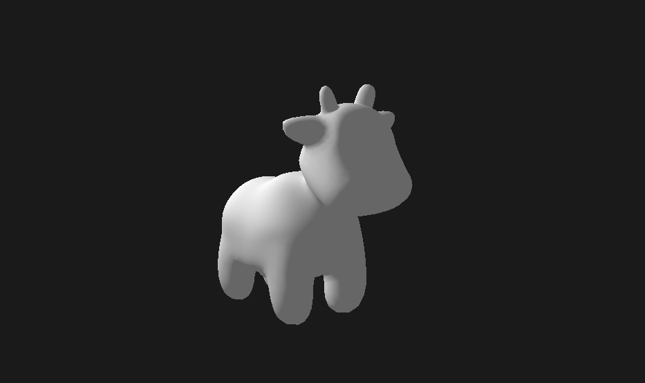

# scop

A Wavefront `.obj` viewer written from scratch in [Odin](https://odin-lang.org), using only GLFW and OpenGL 3.3 core. 42 School graphics project.



## What's in it

- **OBJ parser.** Reads positions, texture coordinates, normals and faces.
- **Vertex deduplication.** Each unique `v/vt/vn` corner becomes one vertex in an index buffer, so shared corners are uploaded once.
- **Smooth normals.** Generated per vertex when the file doesn't provide them.
- **Own math library.** `vmath` implements the vectors and matrices (translate, rotate, perspective, look-at) instead of using `core:math/linalg`, because why not.
- **Lighting.** Diffuse shading with an ambient term from a fixed light source placed relative to the model's size, drawn as a small octahedron.
- **Texturing.** Press `T` to blend a BMP texture over the shaded model with a smooth fade.
- **Camera.** Framed automatically from the model's bounding radius, with mouse orbit and scroll zoom.
- **Memory checks.** Debug builds run with a tracking allocator and report leaks and bad frees on exit.

## Build and run

Needs the Odin compiler.

```sh
odin build src -out:scop
./scop ./resources/stanford-bunny.obj
```

For a debug build with leak tracking:

```sh
odin build src -out:scop -debug
```

Sample models are in `resources/`.

## Controls

| Input | Action |
|---|---|
| Drag mouse | Orbit the camera around the model |
| Scroll | Zoom |
| `Enter` | Start / stop auto-rotation |
| `X` / `Y` / `Z` | Move the model along that axis (`Shift` to reverse) |
| `Alt` + `X` / `Y` / `Z` | Rotate the model around that axis (`Shift` to reverse) |
| `T` | Fade the texture in / out |
| `Esc` | Quit |

## Layout

```
src/
  parser/    OBJ parsing and face handling
  mesh/      CPU-side mesh, bounds, normals
  vmath/     vectors and matrices
  scene/     camera, light, objects
  renderer/  GPU buffers, shaders, textures
  platform/  window and input (GLFW)
  shaders/   GLSL
```
